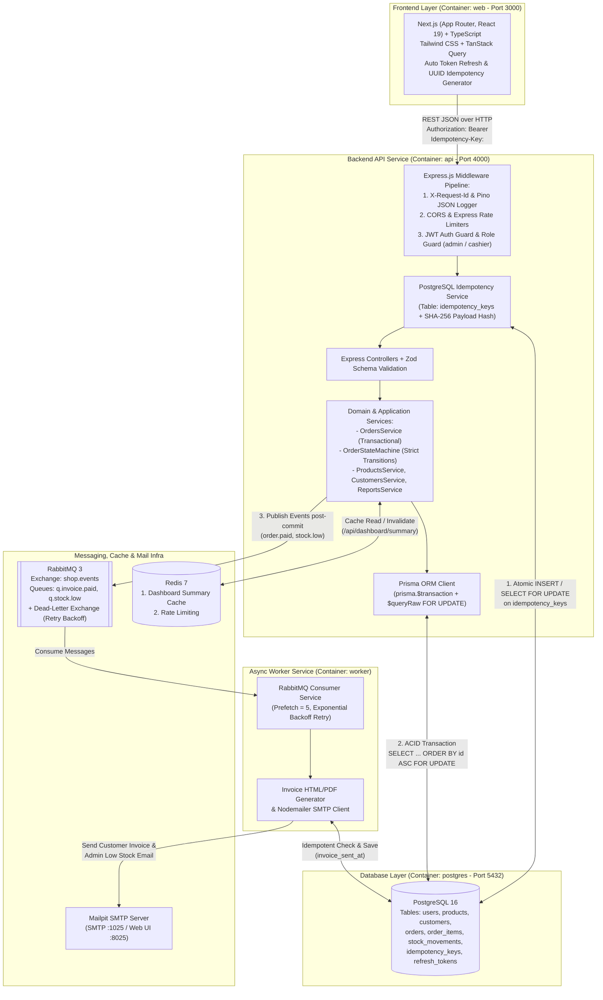

# System Architecture & Technical Design

## Sistem Online Shop (Order Management) — Production-Grade
**Repository**: [echoTech187/azatech](https://github.com/echoTech187/azatech)  
**Track**: Track A (Custom Production Stack) — Node.js 24 LTS, Express.js (TypeScript Strict Mode), Prisma ORM, PostgreSQL 16, RabbitMQ, Redis 7, Next.js 15, Tailwind CSS.

---

## 1. Diagram Arsitektur Sistem (Mermaid)



---

## 2. Struktur Layer & Modul

Sistem mengadopsi pola **Layered Modular Architecture** di dalam Express.js untuk memastikan *Separation of Concerns* antara HTTP transport (`req`/`res`), domain state machine, aturan bisnis konsistensi stok, dan integrasi persistence:

```
.
├── .github/
│   └── workflows/
│       └── ci.yml                            # GitHub Actions CI Workflow
├── api/                                      # Express.js + TypeScript (Strict Mode) + Prisma
│   ├── Dockerfile                            # Multi-stage Dockerfile (non-root user: node)
│   ├── prisma/
│   │   ├── schema.prisma                     # Skema Prisma & covering indexes
│   │   ├── migrations/                       # SQL migrations + CHECK (stock >= 0) constraint
│   │   └── seed.ts                           # Seeder: 1 admin, 1 cashier, 50 produk, 30 customer, 150 order (90 hari)
│   ├── src/
│   │   ├── config/                           # env (Zod validated), Prisma, Redis, RabbitMQ, Mailer, Swagger
│   │   ├── common/                           # Standard response formatter & AppError classes
│   │   ├── middlewares/                      # request-id, auth, rbac, idempotency, rate-limit, error handler
│   │   ├── modules/
│   │   │   ├── auth/                         # Token rotation, bcrypt authentication
│   │   │   ├── products/                     # Product catalog & stock ledger management
│   │   │   ├── customers/                    # Customer records with strict cashier deletion restriction
│   │   │   ├── orders/                       # Order transactional engine & OrderStateMachine
│   │   │   ├── reports/                      # SQL aggregate reports & Redis caching
│   │   │   └── health/                       # Health check for DB, Redis, and RabbitMQ
│   │   ├── workers/                          # RabbitMQ topology, invoice consumer, low-stock consumer
│   │   ├── app.ts                            # Express application setup
│   │   ├── server.ts                         # API server entrypoint
│   │   └── worker.ts                         # Worker standalone entrypoint
│   └── tests/
│       ├── unit/                             # order-state-machine.test.ts
│       └── integration/                      # concurrency-and-idempotency.test.ts, rbac-and-double-cancel.test.ts
├── web/                                      # Next.js 15 (App Router, React 19) + Tailwind CSS
│   ├── Dockerfile                            # Multi-stage Dockerfile (non-root user: node)
│   └── src/
│       ├── app/                              # Pages (/login, /dashboard, /products, /customers, /orders, /reports)
│       ├── components/                       # UI components, dynamic forms, order timeline, bar charts
│       ├── hooks/                            # TanStack Query hooks & URL query sync
│       └── lib/                              # Axios API client with automatic token refresh queue
├── docker-compose.yml                        # Production-ready orchestration
├── .env.example
├── README.md
└── ARCHITECTURE.md
```

---

## 3. Desain Skema Database & Integritas Relasional

### 3.1 Constraints Level Database (PostgreSQL)
Selain validasi aplikasi via Zod, integritas data dilindungi langsung oleh PostgreSQL constraints:
1. `chk_products_stock_non_negative`: `CHECK ("stock" >= 0)` — Mencegah *overselling* secara fisik di level storage engine.
2. `chk_products_price_positive`: `CHECK ("price" > 0)` — Memastikan seluruh harga produk bernilai positif.
3. `chk_order_items_qty_positive`: `CHECK ("quantity" > 0)` — Mencegah kuantitas item nol atau negatif.
4. `UNIQUE ("product_code")` & `UNIQUE ("order_number")` — Menjamin keunikan kode SKU dan nomor transaksi.

### 3.2 Strategi Indexing
- `idx_products_active_name`: `(deleted_at, product_name)` — Mempercepat katalog produk aktif dengan soft delete.
- `idx_customers_active_name`: `(deleted_at, customer_name)` — Mempercepat pencarian pelanggan aktif.
- `idx_orders_date_status`: `(order_date, status)` — Mengoptimasi query laporan agregasi harian/bulanan.
- `idx_orders_customer_date`: `(customer_id, order_date DESC)` — Mempercepat riwayat transaksi per pelanggan.
- `idx_stock_movements_product_date`: `(product_id, created_at DESC)` — Menjamin drawer riwayat pergerakan stok tampil instan.
- `idx_idempotency_expires`: `(expires_at)` — Memungkinkan cleanup worker membersihkan key kadaluarsa secara efisien.

---

## 4. Architecture Decision Records (ADR)

### ADR-001: Konsistensi Stok & Penanganan Concurrency dengan Pessimistic Locking (`SELECT ... FOR UPDATE`)

- **Konteks**: Pada skenario diskon atau jam sibuk, beberapa kasir dapat membuat order secara simultan untuk produk yang sama. Tanpa mekanisme locking yang tepat, dua transaksi paralel akan membaca saldo stok awal yang sama (*race condition*), berakibat pada *overselling*. Selain itu, pada pesanan multi-item, jika Transaksi A mengunci Produk 1 lalu Produk 2, sementara Transaksi B mengunci Produk 2 lalu Produk 1, database akan mengalami **Deadlock**.
- **Opsi yang Dipertimbangkan**:
  1. *Optimistic Concurrency Control (`version` column)*: Menyebabkan badai penolakan dan retry beruntun (*retry storm*) saat stok menipis.
  2. *Conditional Atomic Update (`UPDATE ... WHERE stock >= qty`)*: Mencegah stok minus, namun sulit mencatat histori audit `stock_movements` (snapshot `stock_after`) secara atomik untuk multi-item.
  3. *Pessimistic Row-Level Locking (`SELECT ... FOR UPDATE`) dengan Pengurutan ID Deterministik + PostgreSQL `CHECK (stock >= 0)`*.
- **Keputusan**: **Memilih Opsi 3 (Pessimistic Locking dengan Deterministic Lock Ordering)**.
  - Di dalam `prisma.$transaction`, seluruh `product_id` diurutkan secara menaik (`ORDER BY id ASC`) sebelum dikunci menggunakan raw SQL `SELECT ... FOR UPDATE`.
  - Urutan penguncian baris yang identik secara global mengeliminasi siklus tunggu antar-transaksi (100% bebas deadlock).
  - Jika salah satu item memiliki stok kurang dari yang diminta, seluruh transaksi di-rollback secara utuh dengan error `422 Unprocessable Entity` yang memerinci item bermasalah.
- **Konsekuensi**:
  - **Positif**: 0% resiko overselling (terbukti pada uji konkurensi 20 request paralel terhadap produk dengan sisa stok 5 menghasilkan tepat 5 transaksi sukses dan 15 transaksi ditolak dengan stok akhir 0).
  - **Trade-off**: Transaksi untuk produk yang sama dieksekusi secara serial di level baris. Oleh karena itu, operasi non-kritis (pembuatan PDF invoice dan pengiriman email) dikeluarkan dari transaksi DB dan didelegasikan ke RabbitMQ.

---

### ADR-002: Penyimpanan Idempotency Key di Tabel PostgreSQL (`idempotency_keys`)

- **Konteks**: Request `POST /api/orders` rentan terhadap transmisi ganda akibat latensi jaringan kasir atau klik berulang. Sistem wajib menjamin bahwa request dengan `Idempotency-Key` yang sama mengembalikan respons identik tanpa menduplikasi potongan stok maupun pembuatan record order.
- **Opsi yang Dipertimbangkan**:
  1. *Redis Cache Key*: Cepat, namun berada di luar batas transaksi PostgreSQL sehingga rentan terhadap ketidaksinkronan (*dual-write hazard* jika server crash di antara keduanya).
  2. *Tabel PostgreSQL `idempotency_keys`*: Memanfaatkan sifat ACID dan constraint database yang sama dengan data order.
- **Keputusan**: **Memilih Opsi 2 (Tabel PostgreSQL `idempotency_keys` dengan Payload Hash SHA-256 dan TTL 24 Jam)**.
  - Server menghitung `request_hash = SHA256(user_id + customer_id + canonical_items_json)`.
  - Menginisialisasi status `PROCESSING` dengan `locked_until = NOW() + 60s`.
  - Jika key sudah ada:
    - Apabila `request_hash` berbeda: Tolak dengan `422 Unprocessable Entity` (*Payload mismatch*).
    - Apabila masih `PROCESSING`: Tolak dengan `409 Conflict` (*Concurrent processing*).
    - Apabila `COMPLETED`: Langsung kembalikan snapshot response yang tersimpan (`response_code: 201`, `response_body`) tanpa memproses ulang order.
  - Finalisasi status `COMPLETED` dan penyimpanan `response_body` dieksekusi dalam transaksi database yang sama dengan pencatatan order.
- **Konsekuensi**:
  - **Positif**: Konsistensi 100% atomik (mustahil order terbentuk tanpa tercatat di tabel idempotency).
  - **Trade-off**: Sedikit overhead I/O tambahan pada tabel idempotency, yang diatasi dengan index pada `expires_at` untuk pembersihan rutin.

---

### ADR-003: Autentikasi JWT dengan Database Refresh Token Rotation

- **Konteks**: Arsitektur terpisah antara API Express dan Frontend Next.js memerlukan mekanisme otentikasi yang aman terhadap pencurian token (*token theft*) dan *replay attack*.
- **Opsi yang Dipertimbangkan**:
  1. *Stateless Refresh Token*: Sulit membatalkan sesi sebelum masa berlaku token habis.
  2. *Short-Lived JWT Access Token (15 menit) + Stateful Refresh Token Rotation di Database*.
- **Keputusan**: **Memilih Opsi 2**.
  - `access_token` berumur 15 menit diverifikasi secara stateless via public/symmetric secret.
  - `refresh_token` (umur 7 hari) disimpan dalam bentuk hash `SHA-256` di tabel `refresh_tokens`.
  - Setiap pemanggilan `POST /api/auth/refresh`:
    - Token lama langsung ditandai `revoked_at = NOW()` dan digantikan oleh pasangan token baru.
    - Jika sistem mendeteksi token yang sudah bertanda `revoked_at` digunakan kembali, sistem mengidentifikasi insiden keamanan, mencabut seluruh token aktif milik user tersebut, dan mengembalikan `401 Unauthorized`.
- **Konsekuensi**:
  - **Positif**: Tingkat keamanan tinggi dengan deteksi penggunaan ulang (*reuse detection*).
  - **Trade-off**: Di sisi Next.js, dipasang Axios Response Interceptor dengan antrean permintaan (*mutex*) agar refresh token tidak terpanggil berkali-kali secara simultan saat beberapa request komponen kadaluarsa bersamaan.

---

### ADR-004: RabbitMQ (Dead-Letter Exchange) untuk Async Background Jobs & Redis untuk Caching

- **Konteks**: Pembuatan invoice PDF/HTML, pengiriman email SMTP via Mailpit, dan notifikasi stok menipis memerlukan pemrosesan di luar siklus HTTP request kasir agar waktu respons tetap berada di bawah 200ms. Di sisi lain, query dashboard agregasi memerlukan in-memory cache cepat.
- **Opsi yang Dipertimbangkan**:
  1. *Redis untuk Queue (BullMQ) dan Cache*: Menyatukan broker pesan dan cache pada satu engine.
  2. *RabbitMQ (`amqplib`) sebagai Dedicated Message Broker + Redis untuk In-Memory Cache*.
- **Keputusan**: **Memilih Opsi 2**.
  - **RabbitMQ**: Mengelola antrean dengan *Topic Exchange* (`shop.events`), work queues (`q.invoice.paid`, `q.stock.low`), dead-letter exchange (`dlx.shop.events`), serta exponential backoff retry (5s, 25s, 125s). Kolom `orders.invoice_sent_at` menjamin worker tidak mengirim email ganda saat job di-retry.
  - **Redis 7**: Digunakan untuk in-memory cache `/api/dashboard/summary` (TTL 5 menit) dengan invalidasi proaktif saat ada mutasi order/stok, serta rate limiting terdistribusi.
- **Konsekuensi**:
  - **Positif**: Beban kerja asinkron terisolasi sempurna dari antrean cache, reliabilitas tinggi dengan jaminan pengiriman pesan RabbitMQ yang kuat.
  - **Trade-off**: Penambahan satu kontainer RabbitMQ ringan di Docker Compose. Endpoint `/api/health` memverifikasi kesiapan ketiga komponen (PostgreSQL, Redis, RabbitMQ).

---

## 5. Strategi Skalabilitas: 50.000 Order / Hari dari Multi-Cabang

Untuk mendukung throughput **50.000 order/hari** (~5–8 order/detik rata-rata, puncak 40–50 order/detik saat flash sale) dari puluhan cabang, arsitektur dapat dikembangkan melalui langkah-langkah terukur berikut:

### 5.1 Pemisahan Stok Per Cabang (`branch_inventories`)
- **Masalah**: Pada sistem terpusat, penguncian baris `SELECT ... FOR UPDATE` pada tabel `products` akan menyebabkan contention global jika banyak cabang menjual barang yang sama.
- **Solusi**: Memindahkan kuantitas stok ke tabel relasi:
  ```sql
  CREATE TABLE branch_inventories (
    id BIGSERIAL PRIMARY KEY,
    branch_id UUID NOT NULL REFERENCES branches(id),
    product_id BIGINT NOT NULL REFERENCES products(id),
    stock INT NOT NULL CHECK (stock >= 0),
    low_stock_threshold INT NOT NULL DEFAULT 5,
    CONSTRAINT uq_branch_product UNIQUE (branch_id, product_id)
  );
  ```
- **Dampak**: Kasir di Cabang Surabaya hanya mengunci baris stok milik Cabang Surabaya, menghilangkan *lock contention* antar cabang secara total.

### 5.2 Transactional Outbox Pattern
- **Masalah**: Memanggil RabbitMQ `publish()` setelah `COMMIT` database berisiko kehilangan event jika koneksi jaringan atau proses Express mati tepat di antara kedua tahap tersebut (*dual-write hazard*).
- **Solusi**: Menyimpan pesan event ke dalam tabel PostgreSQL `outbox_events` di dalam transaksi yang sama dengan pembuatan order, lalu memanfaatkan Debezium CDC (Change Data Capture) atau Outbox Poller Worker untuk meneruskan event ke RabbitMQ dengan jaminan *At-Least-Once Delivery*.

### 5.3 PostgreSQL Read Replica & Pre-Aggregated Rollups
- **Masalah**: Menjalankan query agregasi `SUM(total_amount)` di atas jutaan baris order akan membebani database operasional kasir.
- **Solusi**:
  - Mengarahkan seluruh query analitik laporan (`/api/reports/*`) ke **PostgreSQL Read Replica**.
  - Menggunakan tabel pra-agregasi **`daily_sales_rollups`** yang di-update secara asinkron via RabbitMQ consumer saat order berstatus `PAID` atau `CANCELLED`. Query dashboard berubah dari *full table scan* menjadi *index lookup* O(1).

### 5.4 PostgreSQL Declarative Range Partitioning
- **Masalah**: Tabel `orders`, `order_items`, dan `stock_movements` bertambah ~1,5 juta order dan ~6 juta baris ledger per bulan.
- **Solusi**: Menerapkan PostgreSQL Range Partitioning berbasis bulan (`PARTITION BY RANGE (order_date)`). Data transaksi historis yang berumur lebih dari 1 tahun dapat diarsipkan (*cold storage*) atau dipindahkan ke tabel terpisah tanpa memblokir tabel utama.

### 5.5 Distributed Invoice Number Generation
- **Solusi**: Menghindari locking sekuensial dengan format nomor invoice terdistribusi yang memadukan kode cabang, tanggal, dan Redis Atomic Counter:
  `INV-{BRANCH_CODE}-{YYYYMMDD}-{REDIS_INCR_PAD}`.
